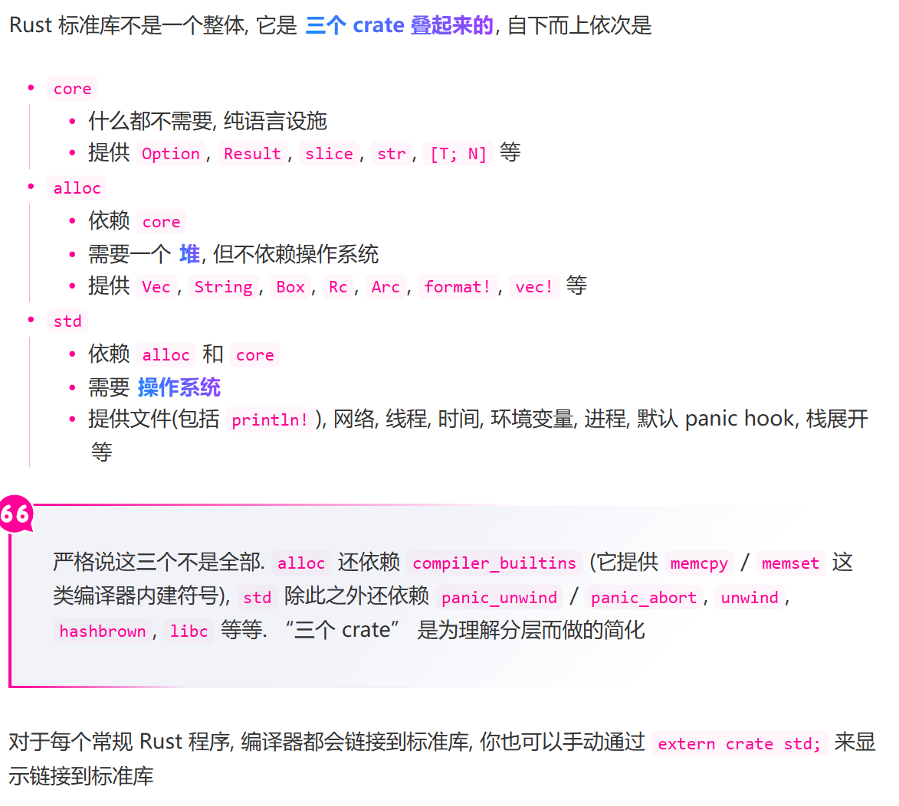
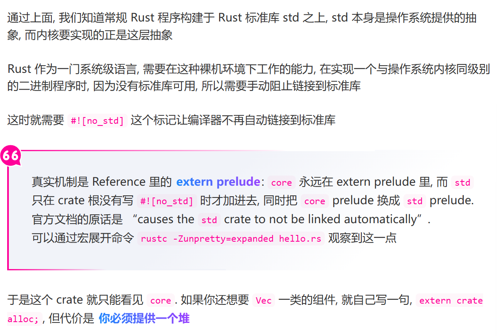
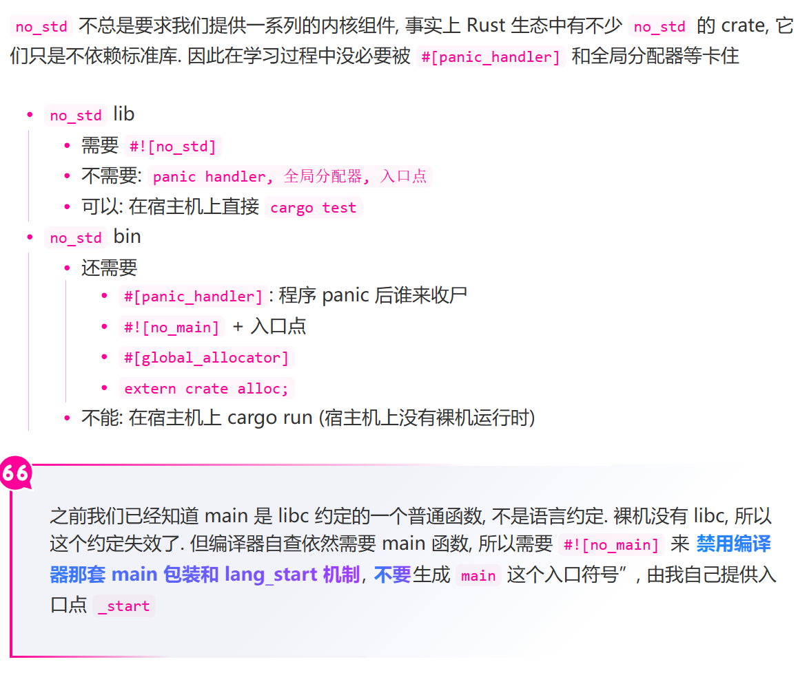
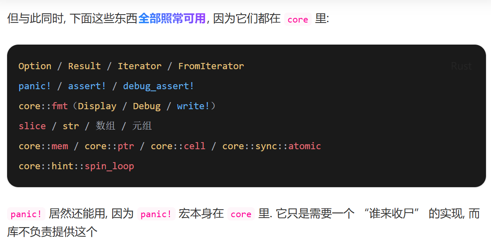
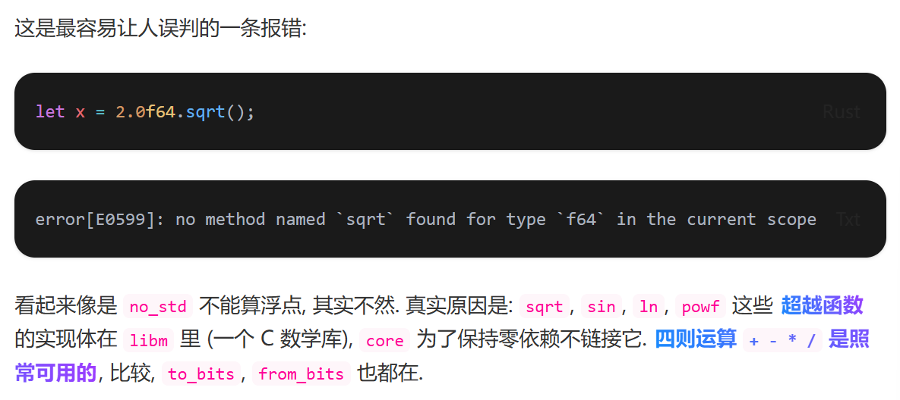
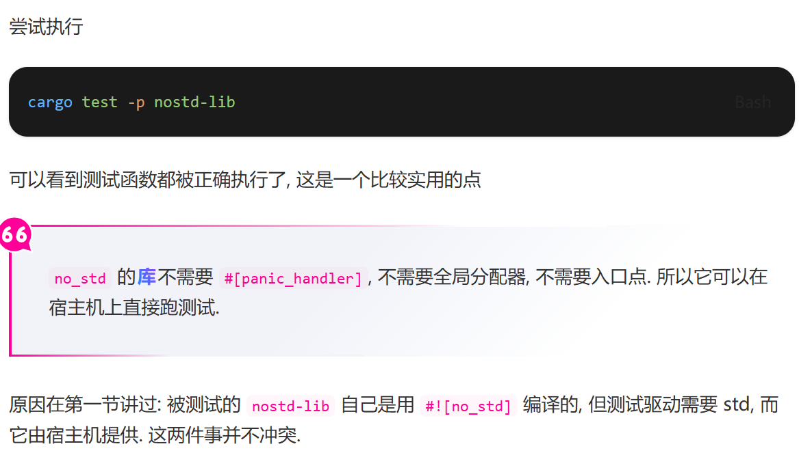
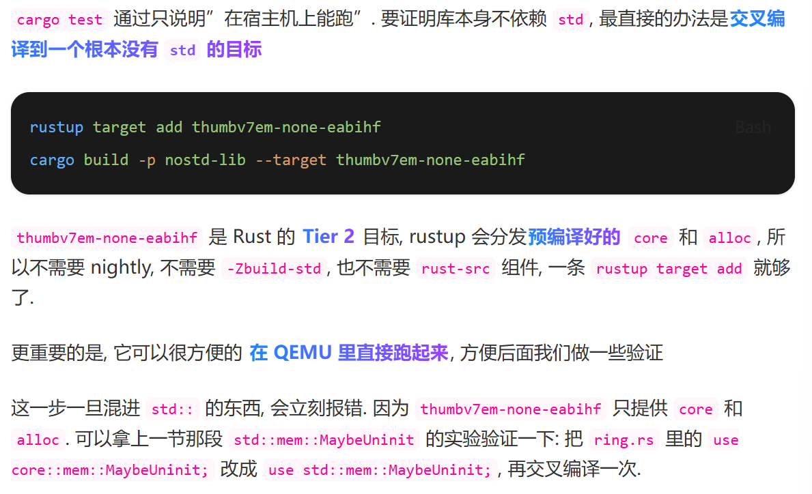
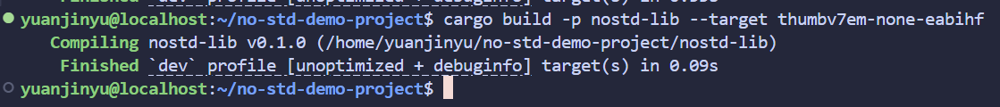
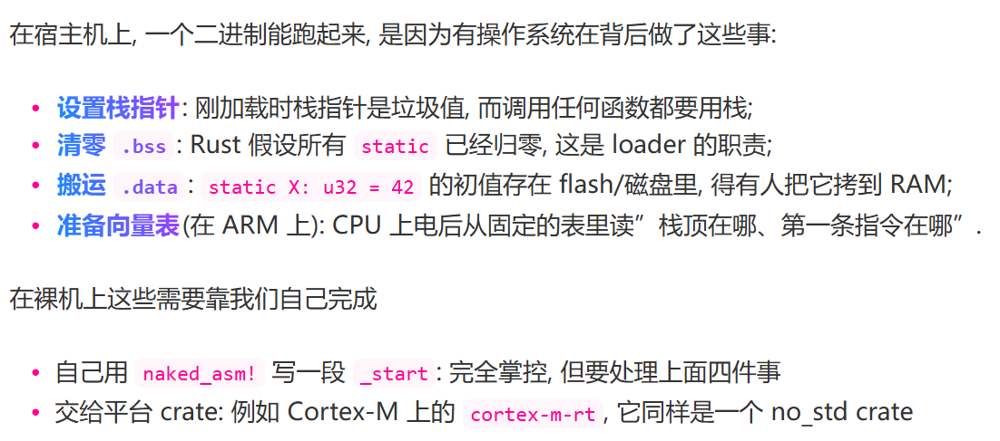
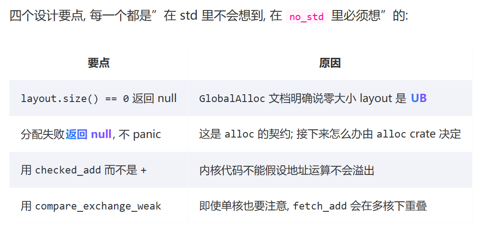

# Rust no_std 编程

> 本篇当中的内容来自于一篇技术博客，讲解了关于 no_std 编程的相关知识，自己对于其中的项目进行复现的同时，写下一些自己的理解和注意点
>
> [链接](https://fontlos.com/post/2026-09-25)
>
> 复现的项目在 wsl2 上，`~/no-std-demo-project`

--- 

## Rust 程序的启动链路


```rust
fn main(){
    println!("Hello,world!");
}
```

对于上面这样的代码，我们知道的是这个 main 函数的返回类型为 () ，有些情况下也可以返回一个 Result<T,E> 或者是 ! 这样的类型。引发的一个问题就是，这个返回值由谁来接收呢？联想到 C 语言当中的 `int main() {  ... return 0; }` 。为什么返回值为 0 的时候代表成功，返回值为其它值的时候代表出错？这些都指向了一个内容，就是一定有一个比 main 函数更早启动，更晚退出的函数来处理这个 main 函数，进行程序的初始化和收尾操作。暂且叫他 `隐型函数`


> 进行一点补充，就是关于 Rust 当中的对于 main 函数的要求，main 函数要求是没有参数，且返回类型需要实现 Termination 这个 trait ，这样的话才可以正确返回。一般的 ()、!、ExitCode 以及 Result<T,E> where E:Debug 都实现了这个 trait。具体的可以看 [Rust启动函数从 main 到 lang 属性](./辅助理解/1.%20Rust启动函数从%20main%20到%20lang%20属性.md)


那么这个隐型函数是谁提供的呢？以 **x86_64-unknown-linux-gnu** 为例，这个函数就是 `libc` 提供的 `__libc_start_main`


> 第一次看到这里的时候，势必会产生这样一个问题（for me）：什么是 gnu？不是Rust语言嘛，为什么需要用到 libc 呢？回答这个问题的话，是需要用到 OS 的相关知识的，这里进行一个补充：[从 libc 角度理解 main 函数启动](./辅助理解/2.%20从%20libc%20出发理解main函数启动.md)


简单展示一下，上面的 Rust 代码的完整展开，是伪代码

```rust

// 这段代码无法编译

// ===== 内核跳转到 ELF 入口点 =====
#[unsafe(no_mangle)]
pub unsafe extern "C" fn _start() -> ! {
    // 栈顶是内核压入的 argc/argv/envp
    let argc: isize = read_argc_from_stack();
    let argv: *const *const u8 = read_argv_from_stack();

    // 把 main 的地址和参数交给 libc
    __libc_start_main(main, argc, argv, init, fini, rtld_fini, stack_end);
}

// ===== libc 提供 =====
unsafe fn __libc_start_main(
    main_fn: extern "C" fn(i32, *const *const u8, *const *const u8) -> i32,
    argc: isize,
    argv: *const *const u8,
    init: extern "C" fn(),
    fini: extern "C" fn(),
    rtld_fini: extern "C" fn(),
    stack_end: *mut core::ffi::c_void,
) -> ! {
    init_libc();   // TLS, canary, .init_array, 线程支持...
    let ret = main_fn(argc, argv, envp);
    exit(ret);
}

// ===== Rust 编译器生成 (codegen 直接声明, 不是源码里的 item) =====
#[unsafe(no_mangle)]
pub extern "C" fn main(argc: i32, argv: *const *const u8) -> i32 {
    // 注意: 它不直接调用用户的 main, 而是把函数指针交给 lang_start
    lang_start(user_main, argc, argv, sigpipe) as i32
}

// ===== Rust std 提供 =====
fn lang_start<T: Termination + 'static>(
    user_main: fn() -> T,
    argc: isize,
    argv: *const *const u8,
    sigpipe: u8,
) -> isize {
    lang_start_internal(&move || user_main().report().to_i32(), argc, argv, sigpipe)
}

fn lang_start_internal(
    main: &(dyn Fn() -> i32 + Sync + RefUnwindSafe),
    argc: isize,
    argv: *const *const u8,
    sigpipe: u8,
) -> isize {
    let exit_code = catch_unwind(main);
    cleanup();
    exit_code.unwrap_or(101)
}

// ===== 用户代码 =====
fn user_main() {
    println!("Hello, World!");
}
```

为什么 Rust 需要这层封装? 因为 Rust 的标准库 **std** 承诺了一些 **程序级** 的语义, 这些语义必须在 main 之外维护, 例如

- panic 的捕获与报告: **lang_start** 用 **catch_unwind** 包裹用户 **main**, 这样 **panic!** 不会直接让内核崩溃, 而是被转换为退出码 **101**
- 线程 guard 与栈溢出检测: std 运行时会在启动时注册 SIGSEGV/SIGBUS 处理器, 并记下主线程栈预期的 guard 区间, 这样栈溢出能变成一条可诊断的信息而不是一个裸的信号

这些职责没有地方可放, 它们发生在 main 之前 和 之后 所以必须有一个封装层来承载, 而链接到 libc 是因为链接一个已经存在的库是最省力的工程选择. libc 已经提供了 _start, 系统调用封装, 内存分配, 文件 I/O, 线程原语等一整套宿主接口. Rust 的 std 如果要在 Unix 上重新实现这些, 工作量巨大, 收益却很低, 而且会破坏与 C 库的 FFI 互操作性


> 最简答，最直白的一个理解就是，在启动 main 函数进行了 系统调用 ，来完成一些必要的操作，在一个OS上，使用对应的 系统调用库 ，可以减小标准库的压力！但是呢，自己写内核的话，就要 no_std 编程，自己考虑这些问题了


--- 

## Rust 标准库



注意了，alloc 是依赖一个堆的，那么也就意味着，自己写内核的时候，需要手动地提供一个堆，并且进行处理

--- 

## 为什么需要 no_std 



使用 `#![no_std]` 阻止编译器自动链接到标准库，因为 `extern prelude` 也就是预导入模块，core 永远在预导入当中，只有在 crate根 当中写入 `#![no_std]` 的才不会自动链接到标准库。可能听起来有点怪，core 在预导入当中，只有写入 ... 才不会自动链接，这是什么意思呢？举一个例子就是使用 Vec 的时候，一般是不需要写 `use std::collections::Vec` 的，这就是因为在预导入模块当中，加入了 Vec，但 Vec 是在 std 当中的，就是因为自动链接到标准库了，这一点才得以实现！

Vec 也被定义在了 alloc 当中，如果想要在 no_std 环境下，使用 Vec 的话，就利用 `extern crate alloc`，但必须提供一个 **堆**！


--- 

### 库 ≠ 二进制




强调以下内容：
1. 在 no_std bin 当中，需要提供 #[panic_handler] 也就是程序 panic 了，谁来进行后续收尾。以及 #[global_allocator] 也就是一个堆内存的全局分配器，当使用 Vec String 等 alloc 提供的数据类型时需要考虑到！
2. 因为没有了 std ，那么也就是无法使用 std 提供的对于 libc 当中那个 `隐型函数` 的调用了，也就没法使用常规的 lang_start 机制（std提供的）。因而，需要自己手写 _start 也就是入口点。因为编译器仍然会检查 main 函数，所以要用 `#![no_main]` 禁用编译器的检查，并且也可以禁用原来的 lang_start 机制（这个在上面的伪代码当中有）


--- 

## 感受 no_std 编程（project示例）

### 从 std 版本开始写

学习 no_std 最有效的方式是反过来: 先写一个正常的版本, 然后一件一件把它依赖的东西拿走, 看它在哪一步开始报错, 报什么错.

我们做一个能同时演示几个典型依赖的小工程: 一个固定容量、满了就顶掉最老元素的 环形缓冲区, 加上一个解析逗号分隔整数的函数, 再加一个生成报告的辅助函数. 它们分别代表 **“容器”** 、**“文本处理”** 和 **“格式化”** 三类最常见的需求.


启动 Cargo 工作区，新建一个 bin crate **demo-std**


no-std-demo-project/demo-std/src/main.rs：

```rust
use std::collections::VecDeque;
use std::fmt;

pub struct HistoryBuffer<T> {
    inner: VecDeque<T>,
    capacity: usize,
}

impl<T> HistoryBuffer<T> {
    pub fn new(capacity: usize) -> Self {
        Self {
            inner: VecDeque::with_capacity(capacity),
            capacity,
        }
    }

    pub fn push(&mut self, value: T) {
        if self.inner.len() == self.capacity {
            self.inner.pop_front();
        }
        self.inner.push_back(value);
    }

    pub fn len(&self) -> usize {
        self.inner.len()
    }

    pub fn is_empty(&self) -> bool {
        self.inner.is_empty()
    }

    pub fn iter(&self) -> impl Iterator<Item = &T> {
        self.inner.iter()
    }
}


#[derive(Debug, Clone, Copy, PartialEq, Eq)]
pub enum ParseError {
    Empty,
    NotANumber,
}

impl fmt::Display for ParseError {
    fn fmt(&self, f: &mut fmt::Formatter<'_>) -> fmt::Result {
        match self {
            ParseError::Empty => write!(f, "input is empty"),
            ParseError::NotANumber => write!(f, "input is not a number"),
        }
    }
}

impl std::error::Error for ParseError {}

/// 解析一行逗号分隔的十进制整数, 返回它们的和
///
/// 这里用了两种 std 才有的东西: `Vec` 收集中间结果, `parse()` 的错误转换
pub fn sum_csv(line: &str) -> Result<u64, ParseError> {
    let trimmed = line.trim();
    if trimmed.is_empty() {
        return Err(ParseError::Empty);
    }

    let mut total: u64 = 0;
    let parts: Vec<&str> = trimmed.split(',').collect();
    for part in parts {
        let n: u64 = part.trim().parse().map_err(|_| ParseError::NotANumber)?;
        total += n;
    }
    Ok(total)
}

/// 生成一段给用户看的报告, 返回 `String`, 每调用一次就在堆上分配一次
pub fn report(values: &[u64]) -> String {
    let mut out = String::new();
    out.push_str("values: ");
    for (i, v) in values.iter().enumerate() {
        if i > 0 {
            out.push_str(", ");
        }
        // format! 内部又会分配一个临时 String
        out.push_str(&format!("{v}"));
    }
    out.push_str(&format!(" | sum = {}", values.iter().sum::<u64>()));
    out
}

pub fn divide(a: u64, b: u64) -> u64 {
    assert!(b != 0, "division by zero: {a} / {b}");
    a / b
}


fn main() {
    println!("== demo-std ==");

    let mut history: HistoryBuffer<&str> = HistoryBuffer::new(3);
    for event in ["boot", "init", "mount", "net", "shell"] {
        history.push(event);
    }
    println!("last 3 events: {:?}", history.iter().collect::<Vec<_>>());

    println!("sum_csv(\"1, 2, 3\") = {:?}", sum_csv("1, 2, 3"));
    println!("sum_csv(\"\")        = {:?}", sum_csv(""));
    println!("report             = {}", report(&[3, 1, 4, 1, 5]));
    println!("divide(42, 6)      = {}", divide(42, 6));
}

#[cfg(test)]
mod tests {
    use super::*;

    #[test]
    fn history_keeps_only_the_latest() {
        let mut h = HistoryBuffer::new(3);
        for v in [1, 2, 3, 4, 5] {
            h.push(v);
        }
        assert_eq!(h.len(), 3);
        assert_eq!(h.iter().copied().collect::<Vec<_>>(), vec![3, 4, 5]);
    }

    #[test]
    fn csv_parsing_works() {
        assert_eq!(sum_csv("1, 2, 3"), Ok(6));
        assert_eq!(sum_csv(""), Err(ParseError::Empty));
        assert_eq!(sum_csv("1, x"), Err(ParseError::NotANumber));
    }
}
```

到这一步, 我们一共有五个对 std 的依赖, 后面要一个个拆掉:

- VecDeque / Vec —— 需要堆
- String / format! —— 需要堆
- println! —— 需要操作系统提供 stdout
- std::error::Error —— 只在 std 里
- panic! + 默认 panic hook —— 需要 std 的 panic 运行时

--- 

### 拆掉第一层：把逻辑搬进 no_std 库

新建一个 lib crate `nostd-lib`。在 nostd-lib/src/lib.rs 文件最前面加上 

```rust
#![no_std]
```

此时这个 crate 当中就看不见 std 了，在 lib.rs 当中敲几句 std 风格代码就会报错了

```rust
pub fn a() -> Vec<u8> { Vec::new() }
pub fn b() -> String { String::from("hi") }
pub fn c() { println!("hi"); }
pub fn d() -> f64 { 2.0f64.sqrt() }
```


```bash
error[E0425]: cannot find type `Vec` in this scope
error[E0433]: cannot find type `Vec` in this scope

error[E0425]: cannot find type `String` in this scope
error[E0433]: cannot find type `String` in this scope

error: cannot find macro `println` in this scope

error[E0599]: no method named `sqrt` found for type `f64` in the current scope
```


这里非常值得看：
- Vec String 没法使用是因为没有导入这个类型
- println! 则是找不到这个宏。println! 这个宏，不是语言本身的！而是从 std 当中导出的！！！
- 超越函数不能用

--- 





这个可以记忆一下，也就是 core 当中哪些还是可用的。panic! 这个语法还是可以使用的，但是必须提供具体的处理实现


使用 `extern crate alloc` 之后，可以使用 Vec String 等在堆上的类型，但是呢，必须提供一个全局分配器

--- 


#### VecDeque没了，把容量写进类型

在 std 版本当中，VecDeque本身的关键在于它是动态容量的，也就是运行时参数，那么就必然牵扯到了堆分配。没有堆分配的话，只能 **把容量编进类型**

新建 `nostd-lib/src/ring.rs`


```rust
use core::mem::MaybeUninit;
use core::ptr;

/// 固定容量, 满了顶掉最老元素的环形缓冲区
///
/// ```txt
///         head（下一个写入位置）
///          |
///   +---+---+---+---+
///   | 3 | 4 |   | 1 |
///   +---+---+---+---+
///              ^
///              tail（下一个读出位置）
///
///   len = 3，逻辑顺序: 1, 3, 4
/// ```
pub struct HistoryBuffer<T,const N:usize >{  // const N:usize 泛型类型常量语法，可以在编译期确定大小
    /// `MayBeUninit<T>` 表示这块内存是给 T 留的，但现在可能是未初始化的
    buf:[MaybeUninit<T>;N],
    /// 下一个写入位置
    head:usize,
    /// 下一个读出位置
    tail:usize,
    /// 当前元素个数
    len:usize
}

impl<T,const N:usize > HistoryBuffer<T,N>{
    pub const fn new()->Self{
        Self{
            buf:[const {MaybeUninit::uninit()};N],
            head:0,
            tail:0,
            len:0,
        }
        
    }

    pub const fn capacity(&self) -> usize {
        N
    }

    pub const fn len(&self) -> usize {
        self.len
    }

    pub const fn is_empty(&self) -> bool { 
        self.len==0
    }

    pub const fn is_full(&self) -> bool {
        self.len==N
    }

}


impl<T,const N:usize> HistoryBuffer<T,N>{
    /// #Safety
    /// `index` 必须小于 `N`
    #[inline]
    unsafe fn slot(&self,index:usize)-> * const T{
        debug_assert!(index<N);
        
        // `MaybeUninit<T>` 和 `T` 布局相同, 可以直接把指针转过去
        // 这个好理解，使用裸指针指向对应位置，返回对应元素的裸指针
        unsafe{
            self.buf.as_ptr().add(index).cast::<T>()
        }
    }


    /// #Safety
    /// `index` 必须小于 `N`
    #[inline]
    unsafe fn slot_mut(&mut self,index:usize) -> *mut T{
        debug_assert!(index<N);
        unsafe{
            self.buf.as_mut_ptr().add(index).cast::<T>()
        }
    }

    /// 推入一个元素，满了就丢掉最老的
    pub fn push(&mut self,value:T){
        if N==0 {
            return;    
        }

        // 先把最老的取出来丢掉，腾出 head 的位置
        if self.is_full(){
            drop(self.pop())
        }

        // SAFETY：head in [0,N)，且 len < N 时这个槽位一定是未初始化的
        unsafe{
            // 裸指针的 写 函数
            // 传入对应位置（head）的可变裸指针，以及对应值
            ptr::write(self.slot_mut(self.head),value);
        }

        self.head = (self.head+1) % N;
        self.len+=1;
    }

    /// 弹出最老的元素
    pub fn pop(&mut self)->Option<T>{
        if self.is_empty(){
            return None;
        }
        
        // SAFETY: tail in [0, N) 且该槽位已被 push 初始化过（len > 0）
        // 用 ptr::read 把值搬走, 此后该槽位逻辑上又变回未初始化
        // 所以下面不会重复 drop
        let value = unsafe{
            ptr::read(self.slot(self.tail))
        };

        self.tail = (self.tail+1) % N;
        self.len-=1;
        Some(value)
    }

    pub fn peek(&self)->Option<&T>{
        if self.is_empty(){
            return None;
        }

        Some(unsafe{&*self.slot(self.tail)})
    }

    // 按逻辑顺序遍历
    pub fn iter(&self) -> impl Iterator<Item=&T> +'_{
        (0..self.len).map(move|i|{
            let index = (self.tail+i) % N;
            
            // SAFETY: i < len ，所以这些槽位已经被初始化
            unsafe{
                &*self.slot(index)
            } 
        })
    }

    
}

// 别忘了 Drop
// 如果 T 不是 Copy (比如 Box<u8>、String), 不实现 Drop 就直接泄漏
impl<T, const N: usize> Drop for HistoryBuffer<T, N> {
    fn drop(&mut self) {
        // pop() 会把取出的值就地 drop 掉
        // 为什么这里可以发生析构呢？就是因为在 pop() 返回了 Option<T> 之后，Option<T> 的作用域结束
        // 因而，Option<T> 被 Rust 自动清理，所以 T 也被清理了
        while self.pop().is_some() {}

        // 也可以用下面的写法
        // 相当于是更加显式地表明析构含义
        // while let Some(value) = self.pop(){
        //     drop(value)
        // }
    }
}


/// 一个会记账的 Drop 类型, 用来验证 `HistoryBuffer` 有没有泄漏
struct DropCounter<'a> {
    counter: &'a core::cell::Cell<u32>,
}

impl Drop for DropCounter<'_> {
    fn drop(&mut self) {
        self.counter.set(self.counter.get() + 1);
    }
}

/// 顶掉老元素时, 那些元素必须被 drop, 而不是泄漏.
#[test]
fn history_buffer_drops_replaced_elements() {
    let dropped = core::cell::Cell::new(0);
    {
        let mut buf: HistoryBuffer<DropCounter<'_>, 4> = HistoryBuffer::new();
        // 塞 10 个进容量 4 的缓冲区: 前 6 个会被顶掉.
        for _ in 0..10 {
            buf.push(DropCounter { counter: &dropped });
        }
        assert_eq!(buf.len(), 4);
        assert_eq!(dropped.get(), 6);
    }
    // 出了作用域, 剩下的 4 个也必须被 drop. 一共 10 次, 没有泄漏.
    assert_eq!(dropped.get(), 10);
}


// ====== 实现迭代器相关 trait ======


impl<'a, T, const N: usize> IntoIterator for &'a HistoryBuffer<T, N> {
    type Item = &'a T;
    type IntoIter = HistoryIter<'a, T, N>;

    fn into_iter(self) -> Self::IntoIter {
        HistoryIter { buf: self, index: 0 }
    }
}

// 单独的一个 HistoryIter，内部是对 HistoryBuffer 的引用
// 那么这个迭代器就不可能拿走 Buffer 当中的所有权，不论是 into_iter() 还是 iter() 
pub struct HistoryIter<'a, T, const N: usize> {
    buf: &'a HistoryBuffer<T, N>,
    index: usize,
}

impl<'a, T, const N: usize> Iterator for HistoryIter<'a, T, N> {
    type Item = &'a T;

    fn next(&mut self) -> Option<Self::Item> {
        if self.index >= self.buf.len {
            return None;
        }
        let slot = (self.buf.tail + self.index) % N;
        self.index += 1;
        // SAFETY: index < len, 槽位一定被初始化过
        Some(unsafe { &*self.buf.slot(slot) })
    }

    fn size_hint(&self) -> (usize, Option<usize>) {
        let remaining = self.buf.len - self.index;
        (remaining, Some(remaining))
    }
}

impl<T, const N: usize> ExactSizeIterator for HistoryIter<'_, T, N> {}
```


> 关于这部分的代码一些补充解释，见：[HistoryBuffer](./辅助理解/3.%20HistoryBuffer.md)。我需要说明的就是，学习其中和 no_std 相关的部分，不是想着去学习整个环形缓冲区本身的思路，而是学习其中和 no_std 相关的内容。重点是如何将一个原本开辟在堆上的数据类型，直接开辟在 栈/static 上，以及一些其它数据类型的用法。比如说：MaybeUninit<T>，以及在内核开发当中的 Drop trait 对元素析构要特别注意。其余的比如说操作裸指针，来实现功能，理解就行


--- 


#### String没了：写一个固定容量的静态版本

String 住在 alloc 里, 它要堆. 但请注意一件事: 纯文本处理本身完全不需要 std. str 的方法、char, 切片, core::fmt 的格式化, 全都在 core 里. 真正缺的只有”动态增长”

新建 `src/fixed_str.rs`
```rust
use core::fmt;
use core::str;


/// 固定容量的 UTF-8 字符串
pub struct FixedString<const N:usize >{
    /// 有效字节在 `buf[0..len]` 里，且保证是合法的 UTF-8
    buf:[u8;N],
    len:usize
}

/// 放不下的时候返回错误
#[derive(Debug,Clone,Copy,PartialEq,Eq)]
pub struct CapacityError;


/* 注意 CapacityError 只实现了 fmt::Display 和 Debug, 没有 实现 std::error::Error, 因为后者只在 std 里. 
这是拆掉第四个依赖的方式: 少一层 trait 而已, 用户看到的错误消息一点没少. */
impl fmt::Display for CapacityError{
    fn fmt(&self, f: &mut fmt::Formatter<'_>) -> fmt::Result {
        f.write_str("fixed-capacity string is full")
    }
}


impl<const N:usize> FixedString<N>{
    // 同样的 const ，使得可以放在 static 当中
    // 也不是说，一定要这样做才对
    pub const fn new()->Self{
        Self{
            buf:[0;N], // 这里不用 const ，直接 0 即可
            len:0
        }
    }

    pub const fn len(&self) -> usize { self.len }
    pub const fn is_empty(&self) -> bool { self.len == 0 }
    pub const fn capacity(&self) -> usize { N }
    pub const fn remaining(&self) -> usize { N - self.len }

    pub fn clear(&mut self) {
        self.len = 0;
    }

    /// 以 `&str` 的形式查看内容
    pub fn as_str(&self) -> &str{

        unsafe{
            str::from_utf8_unchecked(&self.buf[0..self.len])
        }
    }

    /// 追加一段 &str ，放不下时返回 Err 且 不做任何修改
    /// String::push_str() 是没有返回值的，但是这里必须返回 Result 
    /// 因为是固定容量，必须将可能发生的错误让调用者知道！
    pub fn push_str(&mut self,s:&str)->Result<(),CapacityError>{
        let bytes = s.as_bytes();
        if self.remaining() < bytes.len(){
            return Err(CapacityError);
        }

        // 直接 copy_from_slice 即可
        self.buf[self.len..self.len+bytes.len()].copy_from_slice(bytes);
        self.len+=bytes.len();
        Ok(())
    }


    /// 追加一个 `u64` 的十进制表示, 完全不分配
    /// 这个不用纠结，就是将 u64 转为对应的 ASCII 表示了
    pub fn push_u64(&mut self, mut n: u64) -> Result<(), CapacityError> {
        let mut digits = [0u8; 20];
        let mut i = digits.len();
        loop {
            i -= 1;
            digits[i] = b'0' + (n % 10) as u8;
            n /= 10;
            if n == 0 {
                break;
            }
        }
        // SAFETY: digits 里全是 ASCII 数字, 必然是合法 UTF-8
        let s = unsafe { str::from_utf8_unchecked(&digits[i..]) };
        self.push_str(s)
    }


}


/// 实现 fmt::Write，这样的话，`write!(fs,"x ={} ",1)` 也能用
impl<const N:usize > fmt::Write for FixedString<N>{
    fn write_str(&mut self, s: &str) -> fmt::Result {
        self.push_str(s).map_err(|_| fmt::Error)
    }
}

/// 把格式化结果写进调用者提供的缓冲区。
///
/// 这是 `no_std` 世界里非常典型的函数签名, 内存由调用者提供（内存本身由调用者提供，C语言很多都是这样）
pub fn write_report<const N:usize>(
    out:&mut FixedString<N>,
    values:&[u64]
) -> Result<(),CapacityError>{
    use fmt::Write as _ ;

    let mut first = true;
    write!(out,"values: ").map_err(|_|CapacityError)?;
    for v in values{
        // 这里只借用了 out，没有产生任何临时 String
        write!(out,"{}{v}",if first {""} else {", "}).map_err(|_|CapacityError)?;
        first=false;
    }

    write!(out," | sum = {}",values.iter().sum::<u64>()).map_err(|_|CapacityError)
}
```

这一块注意就是在 no_std 环境下的函数前面，**由调用者提供缓冲区**。以及一个就是比较经典的，用 固定容量 替换 动态容量，从而避免堆的使用。整体上，我觉得还是比较好理解的

> 唯一需要补充的只有两个格式化 trait 了：[Display、Write、write!](./辅助理解/4.%20Display、Write、write!.md)


--- 


#### core缺的那一块：浮点超越函数




两个可行的处理方式：

- 自己写算法。比如整数平方根用牛顿迭代就够了：

```rust
// 整数开平方根
pub fn isqrt(n:u64) -> u64 {
    if n<2 {
        return n;
    }

    let bits = 64 - n.leading_zeros(); // n 的有效位数
    let mut x = 1u64 << ((bits+1) / 2 ); // 一个 >= sqrt n 的初值

    loop{
        let y = (x + n / x) / 2;
        if y >= x {
            return x;
        }
        x=y;
    } 
}
```

- 用 **libm** crate。它是 Rust 重写的 libm，可以在 no_std 下用：

```toml
[dependencies]
libm = "0.2"
```

```rust
let x = libm::sqrt(2.0);
```

---- 

#### 顺带一个写分配器会用到的工具

后面要实现分配器, 现在把那个必需的 align_up 也放进 `nostd-lib/src/math.rs`：

```rust
/// 向上取整到 `align` 的倍数, 写分配器时的必备工具
///
/// `align` 必须是 2 的幂
pub const fn align_up(addr: usize, align: usize) -> usize {
    // align 是 2 的幂, (align - 1) 是一串 1, 取反就是掩码
    (addr + align - 1) & !(align - 1)
}
```

这个函数我觉得还是很好理解的，`addr + align - 1` 相当于是将 addr 加到了一个 >= align的整数倍 的位置，然后 `&  !(align-1)` 将最高位以外全部取 0 ，这样就 == align 的整数倍


--- 

现在 nostd-lib/src/lib.rs 把模块声明和再导出补齐:

```rust
#![no_std]

pub mod fixed_str;
pub mod math;
pub mod ring;

pub use fixed_str::{CapacityError, FixedString};
pub use ring::HistoryBuffer;
```

--- 

#### 库的好处：cargo test




注意一下：
- no_std 的 库 crate 不需要 **#[panic_handler]** 不需要 **全局分配器** ，不需要 入口点！可以直接跑测试（[这个在最开始的时候说到了的](#库--二进制)）


--- 

### 交叉编译






是没问题的，代表没有混进去 std 相关逻辑

--- 

### 把它变为二进制


接下来新建 bin crate `nostd-bin`

`nostd-bin/src/main.rs` 先写下最朴素的形态, 只把 `#![no_std]` 加上:

```rust
#![no_std]

fn main() {}
```

然后：
```bash
cargo build -p nostd-bin --target thumbv7em-none-eabihf
```

```bash
error: `#[panic_handler]` function required, but not found
```


注意编译器只报了这一条. 它是硬错误, 所以你暂时看不到别的. 补上 panic handler 之后再看:

```rust
#![no_std]

use core::panic::PanicInfo;

#[panic_handler]
fn p(_: &PanicInfo) -> ! { loop {} }

fn main() {}
```


```bash
error: using `fn main` requires the standard library
  |
  = help: use `#![no_main]` to bypass the Rust generated entrypoint and declare a
          platform specific entrypoint yourself, usually with `#[no_mangle]`
```


这两条报错连起来看, 结论很清楚: 编译器要的从来不是”有没有 libc”, 而是一个入口符号. 要么给它 fn main, 要么写 #![no_main] 然后自己提供入口点, 不能两个都不给.


> 重复一遍: `#![no_main]` 不是 “禁止 main”. 它的语义是 “不要生成 main 这个入口符号”. 所以如果你写了 `#![no_main]` 又留着一个 `fn main`, 那个函数会变成没人调用的死代码(dead_code 警告), 而链接器会另外抱怨找不到入口:
>
> warning: linker stderr: rust-lld: cannot find entry symbol _start; not setting start address
>
> 这些链接期的抱怨默认只是 warning, 所以产出一个跑不起来的映像也可能”构建成功”

`最后一句话的意思是说，你可以既有 #![no_main] 又有 fn main，只是会产生 dead_code 警告和链接器的警告，不会影响构建，但是呢，跑不起来。这肯定是我们不想看到的，所以不要这样做！`

--- 

#### 入口点



> 我认为这一点很重要，就是说，在程序启动之前，一般来说 OS内核 / 启动代码 / libc 的 _start 帮助我们完成了几个必要的操作。包括：
>
> - 设置栈指针
> - 清空 .bss（在清华的OS课程当中也见到了）
> - 搬运一些必要的 .data 数据（外存上的数据搬运到内存上）
> - 向量表
> - 我觉得也可能包括一些寄存器的设置（调用函数的时候）
>
> 总之就是要明白，以前可以使用 std 的话，这些内容，会有 封装层 来做，但是现在！我们必须手动解决这些问题


我们选择后者, 将重点留在 no_std 本身而不是一些汇编. 先加上依赖 **nostd-bin/Cargo.toml**:

```toml
[dependencies]
nostd-lib = { path = "../nostd-lib" }

# cortex-m-rt 提供 Reset 之后的启动代码
cortex-m-rt = { version = "0.7", features = ["set-sp"] }
# semihosting 让 guest 通过调试通道直接往 QEMU 的宿主终端写字
cortex-m-semihosting = "0.5"
```

然后入口点就只是这样一个普通函数:

```rust
use cortex_m_rt::entry;

/// 程序的入口点.
///
/// 注意这里没有汇编, 也没有 `#[unsafe(no_mangle)]`:
/// 栈指针、.bss 清零、.data 搬运这些事由 cortex-m-rt 的 Reset
/// 在调用这个函数之前做完. 在宿主操作系统上, 这些是 loader 的工作.
///
/// `#[entry]` 会把函数导出成 `main` 符号, 并保证签名是 `fn() -> !`.
#[entry]
fn kernel_main() -> ! {
    // ...
    loop {
        core::hint::spin_loop();
    }
}
```

对比一下 x86 上同样的事: 因为 x86 没有一个等效的 cortex-m-rt, 那段 _start 得自己写, 而且必须是裸汇编:

```rust
// 在 x86_64-unknown-none 上你得自己写这个, 而且只能用 sym / const 两种操作数
#[unsafe(naked)]
#[unsafe(no_mangle)]
#[unsafe(link_section = ".text.entry")] // 告诉 linker 这是ELF 文件的 .text.entry 入口处
unsafe extern "C" fn _start() -> ! {
    core::arch::naked_asm!(
        "lea  rsp, [rip + {stack} + {stack_size}]",   // 设栈
        "and  rsp, -16",
        "movabs rdi, offset __bss_start",             // 清 .bss
        "movabs rcx, offset __bss_end",
        "1:",
        "    cmp  rdi, rcx",
        "    jae  2f",
        "    mov  byte ptr [rdi], 0",
        "    inc  rdi",
        "    jmp  1b",
        "2:",
        "call kernel_main",
        "3:",
        "    hlt",
        "    jmp  3b",
        stack      = sym STACK,
        stack_size = const 16 * 1024,
    )
}
```

两种写法的目的完全一样, 差别只在于 “这些活有没有现成的 crate 干”.

> #[unsafe(no_mangle)]、#[unsafe(link_section)] 这类 unsafe attribute, 在 edition 2024 里必须写成 unsafe(...) 包裹的形式. 而 #[unsafe(naked)] 本身是 2025 年随 Rust 1.88 才稳定的, 在它之前只能靠 global_asm! 手写 .section / .globl.

--- 

> 到这里呢，我觉得需要补充点东西了：[Rust 裸机启动：Cortex-M、x86-64 与函数调用边界](./辅助理解/5.%20Rust%20裸机启动：Cortex-M、x86-64%20与函数调用边界.md)
>
> 另外呢，就是要明白，上方的 `#[entry]` 和 `_start` 可以认为是做了相同的事情，就是在程序启动之前必须的初始化操作。`kernal_main` 就是启动之后的入口函数了，但是在下方的 `_start` 当中只是进行了必要的初始化操作，还没有指定入口函数是哪一个！可以在汇编代码当中指定 入口函数 是哪一个


--- 

既然用了 `cortex-m-rt`, 还得告诉它 “内存有多大、从哪开始”. 它会 INCLUDE 一个叫 memory.x 的文件, 所以这个文件必须放在运行 cargo 时的工作目录(也就是工程根目录):


`放在 no-std-demo-project/ 目录下，是整个工作区的根目录！相当于 cargo 工作的时候是在根目录下`


```x
/*
 * 这块板子的内存布局.
 *
 * cortex-m-rt 自带的 link.x 会 INCLUDE 这个文件, 并据此放置
 * 向量表、.text .data .bss 和栈.
 *
 * FLASH 的起始地址必须和 QEMU 机器匹配: lm3s6965evb 的 flash 从
 * 0x00000000 开始, 向量表必须落在 0 地址. 如果按别的板子写成 0x08000000,
 * QEMU 起跳时读不到向量表, 会直接 "Lockup: can't escalate 3 to HardFault".
 */
MEMORY
{
    FLASH : ORIGIN = 0x00000000, LENGTH = 256K
    RAM   : ORIGIN = 0x20000000, LENGTH = 64K
}
```

最后把构建参数写成工程里的别名 `no-std-demo-project/.cargo/config.toml` :

```toml
[alias]
bare = "build -p nostd-bin --target thumbv7em-none-eabihf --config target.thumbv7em-none-eabihf.rustflags=['-C','link-arg=-Tlink.x']"
```

**-Tlink.x** 就是 **cortex-m-rt** 自带的那份链接脚本(它会 include 我们的 memory.x). 之后一条 **cargo bare** 就够了.


> 这里不多说了，一个是关于 Cortex-M 必须的启动参数，一个是关于 Cargo build 的别名，使用 Cargo bare


--- 

#### 最小 panic_handler

`#[panic_handler]` 是任何 `no_std 二进制都必须提供` , 和你有没有用到 `panic!` 无关. 刚刚我们临时使用一个死循环实现, 什么都没做. 现在我们实现一个最小版本

不过我们还没有任何输出设备, 所以只要能编过, 并且让失败可被观测就够了

```rust
use core::panic::PanicInfo;
use cortex_m_semihosting::debug; // 这个 crate 是和 cortex-m-rt 搭配的调试 crate

/// 最小可用的 panic 处理器: 不打印任何东西, 只让 QEMU 以失败码退出.
#[panic_handler]
fn panic(_info: &PanicInfo) -> ! {
    // 让 QEMU 直接结束进程(退出码非 0)
    debug::exit(debug::EXIT_FAILURE);
    loop {
        core::hint::spin_loop();
    }
}
```

两个细节:
- 函数参数是 `#[panic_handler]` 的约定, 不能省略;
- `debug::exit` 只在有调试器(QEMU)时生效, 真机上会直接返回, 所以后面必须跟一个停机循环

--- 

#### println!

新建 `nostd-bin/src/console.rs`:
这一步和硬件无关, 是纯粹的 core::fmt 用法

```rust
use core::fmt;


/// 一个"写到 semihosting stdout"的 `core::fmt::Write` 实现
pub struct HostWriter;


/// 实现 `core::fmt::Write`, 它只有一个必需方法，就是 write_str()
///
/// 只要实现了它, `write!`, `writeln!`, `format_args!` 就全部可用
impl fmt::Write for HostWriter{
    // 这个是必须实现的方法
    // 需要将其写到 semihosting 的 stdout
    // 因此使用对应 crate 提供的标准输出流就可以了
    fn write_str(&mut self, s: &str) -> fmt::Result {
        cortex_m_semihosting::hio::hstdout()
            .map_err(|_| fmt::Error)?
            .write_str(s)
            .map_err(|_| fmt::Error)
    }
}

// 写一个声明宏
#[macro_export]
macro_rules! println {
    () => {
        use core::fmt::Write as _; // 引入 Write trait ，目的是为了使用相关的方法
        let _ = writeln!($crate::console::HostWriter); // 往这个结构体里写数据，因为实现了 Write 所以可以做到，并且写到 semihosting 的 stdout 当中
    };
    ($($arg:tt)*)=>{
        use core::fmt::Write as _;
        let _ = writeln!($crate::console::HostWriter,$(arg)*);
    };
}
```

整条链路上 **没有任何内存分配**: core::fmt 是边格式化边写出去的, Formatter 把结果直接喂给 write_str, 不存在中间 String. 所以 println!("x = {}", x) 在 no_std 里照常可用, 只要 x 实现了 Display.


同一套套路可以用在任何 “能写字节” 的地方:

```text
write!(sink, "...") ──> 只要 sink 实现了 core::fmt::Write
                         ├── semihosting (本节的 HostWriter)
                         ├── 串口 UART (内存映射寄存器)
                         ├── SBI 控制台 (ecall, RISC-V)
                         ├── 内存缓冲区 (下面 logbuf.rs)
                         └── 你自己的任何东西
```

--- 

#### LogBuffer

另外还有一个 `纯内存` 的实现值得看, 它才是本教程真正想强调的例子, 因为 “输出” 这件事和硬件无关, 而且它能在宿主机上被单测

新建 `nostd-bin/src/logbuf.rs`:

```rust
//! 一个**没有任何硬件依赖**的 `core::fmt::Write` 实现: 往内存里的缓冲区写日志
//! 
//! `console.rs` 实际上是依赖于 cortex_m_semihosting 提供的 模拟主机 上的输入输出流的


use core::cell::UnsafeCell;
use core::fmt;


/// 固定容量的日志缓冲区
pub struct LogBuffer<const N:usize>{
    buf:[u8;N],
    len:usize,
    /// 因为放不下而丢掉了多少字节, 静默截断是不可接受的
    /// 调用者至少要知道, 这里丢过东西
    dropped:usize
}

impl<const N: usize> LogBuffer<N> {
    pub const fn new() -> Self {
        Self { buf: [0; N], len: 0, dropped: 0 }
    }

    pub const fn len(&self) -> usize {
        self.len
    }

    /// 已经丢掉的字节数
    pub const fn dropped(&self) -> usize {
        self.dropped
    }

    /// 以 `&str` 的形式查看内容
    pub fn as_str(&self) -> &str {
        // SAFETY: 由类型不变量保证
        unsafe { core::str::from_utf8_unchecked(&self.buf[..self.len]) }
    }
}

impl<const N:usize> fmt::Write for LogBuffer<N>{
    fn write_str(&mut self, s: &str) -> fmt::Result {
        let bytes = s.as_bytes();
        // min(能放多少，需要多少)
        let n  = core::cmp::min(bytes.len(),N-self.len);
        self.buf[self.len..self.len+n].copy_from_slice(&bytes[..n]);
        self.len+=n;
        // 放不下的部分丢掉
        // 注意：这里不能返回 Err 日志缓冲区满了，不应该让程序崩溃
        self.dropped+=bytes.len()-n;
        Ok(())
    }
}


impl<const N: usize> Default for LogBuffer<N> {
    fn default() -> Self {
        Self::new()
    }
}

/// 把 `LogBuffer` 变成可以放进 `static` 的类型
#[repr(transparent)]
pub struct SharedLog<const N: usize>(UnsafeCell<LogBuffer<N>>);

// SAFETY: 调用方必须保证不会真正并发地访问它
unsafe impl<const N: usize> Sync for SharedLog<N> {}

impl<const N: usize> SharedLog<N> {
    pub const fn new() -> Self {
        Self(UnsafeCell::new(LogBuffer::new()))
    }

    /// 拿到内部缓冲区的裸指针
    pub const fn get(&self) -> *mut LogBuffer<N> {
        self.0.get()
    }
}

#[cfg(test)]
mod tests {
    use super::*;
    use core::fmt::Write;

    #[test]
    fn formats_without_any_allocation() {
        let mut log = LogBuffer::<64>::new();
        write!(log, "hello {}, answer = {}", "world", 42).unwrap();
        assert_eq!(log.as_str(), "hello world, answer = 42");
    }

    #[test]
    fn overflow_is_counted_not_silently_dropped() {
        let mut log = LogBuffer::<8>::new();
        write!(log, "0123456789").unwrap();
        assert_eq!(log.as_str(), "01234567");
        assert_eq!(log.dropped(), 2);
    }
}
```

它的测试能在宿主机上跑, 因为 logbuf.rs 里没有任何硬件相关的东西, 完全不依赖标准库

> 我觉得还是需要补充的：[Rust no_std 日志缓冲区：从 static 到  UnsafeCell、Sync与内存布局](./辅助理解/6.%20Rust%20no_std%20日志缓冲区：从%20static%20到%20%20UnsafeCell、Sync与内存布局.md) 里面的内容是上面 logbuf.rs 当中自己不清楚的地方

--- 

#### 全局分配器

到这里二进制已经能编过了, 但还没有堆

alloc 里所有类型都建立在一个假设上: 存在一个 **全局分配器**. 这个假设用一条 trait 表达：

```rust
pub unsafe trait GlobalAlloc {
    unsafe fn alloc(&self, layout: Layout) -> *mut u8;      // 给我一块内存
    unsafe fn dealloc(&self, ptr: *mut u8, layout: Layout); // 还给你
    // alloc_zeroed / realloc 有默认实现，可以先不管
}
```

注意 GlobalAlloc 到今天仍然是 unsafe trait 加 unsafe fn, edition 2024 没有改它的签名


我们实现最简单的一类: bump allocator

```text
  堆的起点                        bump 指针                    堆的终点
    |                                |                             |
    v                                v                             v
    +-------------+------------------+-----------------------------+
    |  已分配…     |      已分配       |        还没用过              |
    +-------------+------------------+-----------------------------+
```

新建 `nostd-bin/src/heap.rs`：
```rust
use nostd_lib::math;

use core::alloc::{GlobalAlloc,Layout}; // 全局分配的 trait 和 Layout 类型是在 core crate 的 alloc 模块 当中
use core::cell::UnsafeCell;
use core::sync::atomic::{AtomicUsize,Ordering};


/// 静态堆的大小，分配 16KB
const HEAP_SIZE:usize=16*1024;


/// 静态堆本体
/// 
/// - `UnsafeCell` 内部可变性
/// - `repr(align(16))` 保证 堆 起点至少 16 字节对齐
/// - `unsafe impl Sync` 下面所有偏移量访问都经过原子操作
///  所以并发调用 `alloc` 也不会拿到重叠区间
#[repr(align(16))]
struct Arena(UnsafeCell<[u8;HEAP_SIZE]>);

// SAFETY: 唯一会写这块内存的是 Bump::alloc,
//         它用 compare_exchange 保证不同 CPU 不会拿到重叠的区间
unsafe impl Sync for Arena {} 

/// 只增不减的分配器
struct Bump{
    arena:Arena,
    /// 下一个空闲字节相对 arena 起点的偏移
    offset:AtomicUsize,
    /// 统计分配次数    
    count:AtomicUsize,
    /// 统计历史最高水位
    peak:AtomicUsize
}


impl Bump{
    // const 函数
    const fn new() -> Self{
        Self{
            arena:Arena(UnsafeCell::new([0;HEAP_SIZE])),
            offset:AtomicUsize::new(0),
            count:AtomicUsize::new(0),
            peak:AtomicUsize::new(0),
        }
    }
}


unsafe impl GlobalAlloc for Bump{
    unsafe fn alloc(&self, layout: Layout) -> *mut u8 {
        
        // 如果请求分配的大小为 0 ，直接返回一个空指针
        // layout.size() == 0 是 UB
        // `Vec` 在 T 是零大小类型时不会走分配器, 但别的调用方可能会
        if layout.size()==0{
            return core::ptr::null_mut();
        }

        // 拿到堆本体的 基地址
        let base = self.arena.0.get().cast::<u8>() as usize;
        let align = layout.align().max(1);
        // 当前指向哪里
        let mut current = self.offset.load(Ordering::Relaxed);

        loop{

            // 1) 当前偏移对齐
            let start = match current.checked_add(align-1){
                Some(_)=>math::align_up(current, align),
                None=>return core::ptr::null_mut(),
            };

            // 2) 检查是否放得下
            let end = match start.checked_add(layout.size()){
                Some(end) if end <= HEAP_SIZE => end,

                // 放不下就返回空指针. **注意**: 这里不要 panic
                // 因为 `alloc` 的契约是 失败返回 null
                // 接下来是 panic 还是别的处理由 alloc crate 决定（相当于是让 alloc 这个 crate 决定后来怎么做）
                _=> return core::ptr::null_mut(),
            };

            // 3) 用 CAS 抢占 [start, end) 这段区间
            match self.offset.compare_exchange_weak(current, end, Ordering::Relaxed, Ordering::Relaxed){
                Ok(_) => {
                    self.count.fetch_add(1, Ordering::Relaxed);
                    self.peak.fetch_max(end, Ordering::Relaxed);
                    // SAFETY: [start, end) 落在 arena 内, 且刚被我们独占
                    return unsafe { (base as *mut u8).add(start) }
                },
                // 别人抢先改了 offset, 拿到新值重试
                Err(actual) => current = actual,
            }
        }

    }


    unsafe fn dealloc(&self,_ptr:*mut u8,_layout:Layout){
        // bump allocator 不复用堆内存
    }

}


/// 注册全局分配器，整个程序里 只能有一个
#[global_allocator]
static ALLOCATOR:Bump = Bump::new();
```



这四点一定要注意！
- layout.size()==0   =>   UB
- 分配失败返回 null
- 使用 checked_add()
- CAS 保证线程安全！即便是单核的也要注意！


最后在加一些辅助函数

```rust
/// 当前已被占走的字节数, 含对齐填充
pub fn used() -> usize {
    ALLOCATOR.offset.load(Ordering::Relaxed)
}

/// 历史最高水位
pub fn peak() -> usize {
    ALLOCATOR.peak.load(Ordering::Relaxed)
}

/// 分配次数
pub fn alloc_count() -> usize {
    ALLOCATOR.count.load(Ordering::Relaxed)
}

/// 堆的总容量
pub const fn capacity() -> usize {
    HEAP_SIZE
}
```


到了这里呢，我有以下几个疑惑，为什么 Arena 这个 “堆本体” **可以保证就是开辟了一块堆呢**？因为其本身的类型还是 `[u8;N]` 的啊。

对齐我是能理解的。如果数据开辟在栈上，那么其数据类型固定，也就是所占的内存大小是固定的，一定是相对于某个固定字节的偏移量。但是在 堆 上的话，是自己组织的，不一定能够保证是相对于某一字节偏移的，比如说，我可能在堆上开辟了 13B 的数据，如果说，还是继续用余下的 3B 的话，就一定不是相对于固定字节的偏移了。必须要对齐。另外对于 Arena 上的 `#[repr(align(16))]` 也就是在说，堆本体（基地址）是对于 16B 的偏移。即便是有外层的包装，也要保证这一点。

具体的实现逻辑呢，我觉得还是很好理解的，自己也做过相关的练习。我觉得自己还是需要理解一下内存对齐这一块的内容。其余的实现逻辑以及一些 并发安全、内部可变性（UnsafeCell 获得裸指针） 、static 全局唯一，的用法，我还是明白的

> 对于上面提到的疑问，也进行了一些补充：[Rust_no_std_Bump_Allocator_内存布局与 const fn 静态初始化](./辅助理解/7.%20Rust_no_std_Bump_Allocator_内存布局与%20const%20fn%20静态初始化.md)


--- 

#### 组装起来

现在 **main.rs** 里把前面几块拼到一起. 这份是完整的 **kernel_main**:
```rust
#![no_std]
#![no_main]


// `alloc` 不在 prelude 里, 必须显式声明这一句
// 之后 `Vec`, `String`, `Box`, `format!` 才可见
extern crate alloc;


mod console;
mod logbuf;
mod heap;


use core::panic::PanicInfo;

use alloc::boxed::Box;
use alloc::format;
use alloc::string::String;
use alloc::vec::Vec;

use cortex_m_rt::entry;
use cortex_m_semihosting::debug;

use nostd_lib::{FixedString, HistoryBuffer};


/// 一个静态日志缓冲区: 不需要任何硬件就能记录信息
static LOG: logbuf::SharedLog<128> = logbuf::SharedLog::new();


// 目前这里报错是 rust-analyzer 的问题，cargo bare 是可以通过的
/// 最小可用的 panic 处理器: 不打印任何东西, 只让 QEMU 以失败码退出.
#[panic_handler]
fn panic(_info: &PanicInfo) -> ! {
    // 让 QEMU 直接结束进程(退出码非 0)
    debug::exit(debug::EXIT_FAILURE);
    loop {
        core::hint::spin_loop();
    }
}


/// 程序的入口点.
///
/// 注意这里没有汇编, 也没有 `#[unsafe(no_mangle)]`:
/// 栈指针、.bss 清零、.data 搬运这些事由 cortex-m-rt 的 Reset
/// 在调用这个函数之前做完. 在宿主操作系统上, 这些是 loader 的工作.
///
/// `#[entry]` 会把函数导出成 `main` 符号, 并保证签名是 `fn() -> !`.
#[entry]
fn kernel_main() -> ! {
    println!("==============================================");
    println!("  rust no_std tour / stage 3");
    println!("  target : thumbv7em-none-eabihf (Cortex-M)");
    println!("  running in QEMU lm3s6965evb");
    println!("==============================================");

    // 1. core 里的东西: 完全不需要堆
    let mut history: HistoryBuffer<&str, 3> = HistoryBuffer::new();
    for event in ["boot", "init", "mount", "net", "shell"] {
        history.push(event);
    }
    println!("[core]  last 3 events (no heap at all):");
    for event in &history {
        println!("          - {}", event);
    }

    let mut fs: FixedString<32> = FixedString::new();
    let _ = fs.push_str("fixed:");
    let _ = fs.push_u64(2026);
    println!("[core]  FixedString = {}", fs.as_str());

    // 2. alloc 里的东西: 现在有堆了
    let mut v: Vec<u32> = Vec::new();
    let (mut a, mut b) = (0u32, 1u32);
    for _ in 0..30 {
        v.push(a);
        let next = a.wrapping_add(b);
        a = b;
        b = next;
    }
    println!("[alloc] Vec<u32> = {:?}", v);

    let mut s: String = String::from("hello, ");
    s.push_str("no_std");
    s.push('!');
    println!("[alloc] String   = {}", s);

    let summary = format!(
        "{} fib numbers, sum = {}",
        v.len(),
        v.iter().map(|x| *x as u64).sum::<u64>()
    );
    println!("[alloc] format!  = {}", summary);

    let boxed: Box<u32> = Box::new(42);
    println!("[alloc] Box<u32> = {}", boxed);

    // 3. 体会这个分配器的代价
    println!();
    println!("[heap]  step 1: ask for 64 KiB, but the heap is only 16 KiB");
    let mut too_big: Vec<u8> = Vec::new();
    match too_big.try_reserve(64 * 1024) {
        Ok(()) => println!("        unexpectedly succeeded"),
        Err(e) => {
            println!("        try_reserve returned Err: {e:?}");
            println!("        ... and the program keeps running");
        }
    }

    println!("[heap]  step 2: allocate 2 KiB, then let it go out of scope");
    let before = heap::used();
    {
        let mut big: Vec<u8> = Vec::new();
        big.try_reserve(2 * 1024).ok();
        big.resize(2 * 1024, 7);
        println!("        while alive, used = {}", heap::used());
    } // <- 出了作用域, Vec 调用 dealloc
    println!(
        "        dropped it, but used is still {} (+{} bytes never came back)",
        heap::used(),
        heap::used() - before
    );

    println!("[heap]  step 3: allocate again, it can only start further ahead");
    let v2: Vec<u32> = (0..8).collect();
    println!("        v2 = {:?}", v2);
    println!("        now used = {}, peak = {}", heap::used(), heap::peak());

    println!();
    println!(
        "[heap]  capacity = {}, allocs = {}, used = {}, peak = {}",
        heap::capacity(),
        heap::alloc_count(),
        heap::used(),
        heap::peak()
    );

    // 4. 纯内存的 fmt::Write: 一个没有硬件的输出设备
    {
        use core::fmt::Write as _;
        // SAFETY: 单核单线程, 没有中断会碰它
        let log = unsafe { &mut *LOG.get() };
        let _ = write!(log, "boot ok; heap used {} bytes", heap::used());
        println!("[log]   LogBuffer = {}", log.as_str());
    }

    println!();
    println!("Done, exiting QEMU.");

    // 让 QEMU 直接结束进程(退出码 0), 不用手动 Ctrl-A X
    debug::exit(debug::EXIT_SUCCESS);

    // debug::exit 依赖调试器, 真机上不生效, 所以还是留一个停机循环
    loop {
        core::hint::spin_loop();
    }
}
```

> 到这里呢，补充一下关于 spin_loop 的内容：[spin_loop与裸机停机循环](./辅助理解/8.%20spin_loop与裸机停机循环.md)
> 
> 


到这里, kernel_main 里用的是 4.2 那个最小的 panic_handler. 它已经够用了, 但我们花了那么大力气做出 println!, 显然希望内核崩溃时能说清楚”崩在哪, 为什么”. 所以最后把它补完

`输出只用 ASCII，防止乱码`

--- 

#### 把 panic_handler 补完

```rust
use core::panic::PanicInfo;

/// panic 处理器: `no_std` 二进制**必须**提供, 且全程序只能有一个
///
/// 三条规则
///   1. 不能再 panic, 否则无限递归, 所以只用 `write!`, 不用 `format!`
///   2. 尽量不分配内存, 分配器本身可能会出问题
///   3. 把位置和消息都打出来, 方便定位
#[panic_handler]
fn panic(info: &PanicInfo) -> ! {
    println!();
    println!("!!! kernel panic !!!");
    // `location()` 返回 Option, 编译器可能没法给出位置
    if let Some(location) = info.location() {
        println!("  at {}:{}:{}", location.file(), location.line(), location.column());
    }
    // `message()` 是 Rust 1.81 起稳定的接口, 返回实现了 `Display` 的 PanicMessage
    println!("  message: {}", info.message());
    println!("(exiting with failure)");

    debug::exit(debug::EXIT_FAILURE);
    loop {
        core::hint::spin_loop();
    }
}
```


> println! 只调用 write_str, 不分配内存, 所以它可以用在 panic_handler 里; 而 format! 不行, 它要先在堆上开一块 String. 在一个 “分配器本身可能已经坏了” 的时刻, 这个区别是致命的
>
> 这个还是挺重要的，如果说，分配器已经坏了，在发生 panic! 的时候，如果用 format! 的话，还是需要开辟 String ，那么此时就无限递归了！这是很可怕的，所以直接使用 write_str，不分配内存，直接往指定的地方去写内容

--- 

### 在 QEMU 里跑起来

到这一步, 我们不只是”编译通过”, 而是真的能运行. 把运行命令也写成别名：
`no-std-demo-project/.cargo/config.toml`：

```toml
run-bare = "run -p nostd-bin --target thumbv7em-none-eabihf --config target.thumbv7em-none-eabihf.rustflags=['-C','link-arg=-Tlink.x'] --config target.thumbv7em-none-eabihf.runner=['qemu-system-arm','-machine','lm3s6965evb','-display','none','-semihosting-config','enable=on,target=native','-kernel']"

# 需要下载 qemu-system-arm 才行
```


```bash
cargo run-bare
```


输出：
```bash
==============================================
  rust no_std tour / stage 3
  target : thumbv7em-none-eabihf (Cortex-M)
  running in QEMU lm3s6965evb
==============================================
[core]  last 3 events (no heap at all):
          - mount
          - net
          - shell
[core]  FixedString = fixed:2026
[alloc] Vec<u32> = [0, 1, 1, 2, 3, 5, 8, 13, 21, 34, 55, 89, 144, 233, 377, 610, 987, 1597, 2584, 4181, 6765, 10946, 17711, 28657, 46368, 75025, 121393, 196418, 317811, 514229]
[alloc] String   = hello, no_std!
[alloc] format!  = 30 fib numbers, sum = 1346268
[alloc] Box<u32> = 42

[heap]  step 1: ask for 64 KiB, but the heap is only 16 KiB
        try_reserve returned Err: TryReserveError { kind: AllocError { layout: Layout { size: 65536, align: 1 (1 << 0) }, non_exhaustive: () } }
        ... and the program keeps running
[heap]  step 2: allocate 2 KiB, then let it go out of scope
        while alive, used = 2356
        dropped it, but used is still 2356 (+2048 bytes never came back)
[heap]  step 3: allocate again, it can only start further ahead
        v2 = [0, 1, 2, 3, 4, 5, 6, 7]
        now used = 2388, peak = 2388

[heap]  capacity = 16384, allocs = 10, used = 2388, peak = 2388

Conclusion: dealloc is a no-op, so nothing ever comes back.
            used only grows, and peak therefore equals used.
            Real kernels use a linked-list / buddy / slab allocator,
            or use a bump allocator only during early boot.
[log]   LogBuffer = boot ok; heap used 2388 bytes

Done, exiting QEMU.
```

最后一行是 debug::exit 让 QEMU 自己退出的, 退出码 0. 没有它的话就得手动按 `Ctrl-A X`

注意这里发生了什么: 这段代码没有任何操作系统, 没有任何驱动, 没有 std. 但它打印了 30 个斐波那契数, 一个 **String**, 一个 **format!** 的结果, 以及一个 **Vec** 的调试输出

--- 

简单看一下编译产物

```bash
llvm-objdump -f target/thumbv7em-none-eabihf/debug/nostd-bin
```

输出：
```bash
target/thumbv7em-none-eabihf/debug/nostd-bin:  file format elf32-littlearm
architecture: arm
start address: 0x00000401
```

入口地址 0x00000401 的最后一位是 1 —— **这是 ARM Thumb 模式的标志位**, 很正常. 再看段布局：

```bash
llvm-objdump -h target/thumbv7em-none-eabihf/debug/nostd-bin
```

输出：

```bash
Idx Name            Size     VMA      Type
  1 .vector_table   00000400 00000000 DATA
  2 .text           0000743c 00000400 TEXT
  3 .rodata         00002dd4 0000783c DATA
  4 .data           00000000 20000000 DATA
  6 .bss            000040a0 20000000 BSS
```


0x00000000 处的 .vector_table 就是前面说的中断向量表, 它由 cortex-m-rt 生成; .bss 落在 RAM 里, 占了 0x40a0 字节(约 16 KiB —— 我们那个静态堆就在里面)


关键符号也都在：

```bash
llvm-objdump -t target/thumbv7em-none-eabihf/debug/nostd-bin | findstr "Reset main __sbss __ebss _stack_start"
```

输出：
```bash
00000400 g     F .text	00000044 Reset
00005880 g     F .text	00000000 DefaultHandler
00001d8a g     F .text	00000008 main
20010000 g       *ABS*	00000000 _stack_start
20000000 g       .bss	00000000 __sbss
200040a0 g       .bss	00000000 __ebss
```

`Reset` 是 CPU 上电后真正执行的第一条指令(由 `cortex-m-rt` 提供), `main` 就是我们的 `kernel_main`


最后, 也是最重要的一步 —— 看看它到底依赖了什么：

```bash
llvm-objdump -t target/thumbv7em-none-eabihf/debug/nostd-bin | findstr std
# 期望: 没有任何输出, 一个 std 符号都没有
```

一个 std 符号都没有, 但程序能打印, 能分配, 能格式化. 这就是 no_std 的全部意义


--- 


> 补充一下关于 llvm 的部分，我觉得对于理解也是挺有帮助的 [从 Rust 源代码到 Cortex-M 机器码：LLVM、ELF 与裸机启动流程](./辅助理解/9.%20从%20Rust%20源代码到%20Cortex-M%20机器码：LLVM、ELF%20与裸机启动流程.md)


--- 

在工作区当中，可以进行如下配置：
`no-std-demo-project/.vscode/settings.json`：

```json
{
    // 修改关于 rust-analyzer 插件 在本项目中的部分功能。哦~
    "rust-analyzer.cargo.target": "thumbv7em-none-eabihf", // 修改构建目标
    "rust-analyzer.cargo.allTargets": false, // 关于全目标的 cargo 构建
    "rust-analyzer.check.allTargets": false // 关于全目标的 cargo check
}
```

`我把它删了，因为会导致 demo-std 报错。就只用下面的了`


`no-std-demo-project/nostd-bin/Cargo.toml`：

```toml
[package]
name = "nostd-bin"
version = "0.1.0"
edition = "2024"


[dependencies]
nostd-lib = { path = "../nostd-lib" }

# cortex-m-rt 提供 Reset 之后的启动代码
cortex-m-rt = { version = "0.7", features = ["set-sp"] }
# semihosting 让 guest 通过调试通道直接往 QEMU 的宿主终端写字
cortex-m-semihosting = "0.5"


[[bin]]
name="nostd-bin"
path="src/main.rs"
test=false # 不要为这个裸机二进制程序构建默认的测试入口。
bench=false # 关闭该二进制目标的基准测试构建
```

这样可以避免 analyzer 报错：panic! 的实现重复。（因为 analyzer 会默认帮助我们构建对应文件的测试环境，在测试环境当中需要使用 std ，且 std 提供了 panic 实现，那么就和我们自己的 panic 实现重复了）

--- 

## 参考资料

### 一、Rust 核心库与内存分配

- [`core` crate 文档](https://doc.rust-lang.org/core/)
- [`alloc` crate 文档](https://doc.rust-lang.org/alloc/)
- [`core::alloc::GlobalAlloc`](https://doc.rust-lang.org/core/alloc/trait.GlobalAlloc.html)

### 二、Rust 语言规范与运行时

- [Rust Reference：Preludes（包括 extern prelude）](https://doc.rust-lang.org/reference/names/preludes.html)
- [Rust Reference：main 函数与 `Termination`](https://doc.rust-lang.org/reference/crates-and-source-files.html#main-functions)
- [`std::process::Termination`](https://doc.rust-lang.org/std/process/trait.Termination.html)
- [Rust 标准库运行时代码：`library/std/src/rt.rs`](https://github.com/rust-lang/rust/blob/master/library/std/src/rt.rs)
- [Rust Platform Support（平台支持）](https://doc.rust-lang.org/rustc/platform-support.html)
- [Edition Guide：Rust 2024](https://doc.rust-lang.org/edition-guide/rust-2024/)

### 三、嵌入式 Rust 与 Cortex-M

- [The Embedonomicon](https://docs.rust-embedded.org/embedonomicon/)
- [The Embedded Rust Book](https://docs.rust-embedded.org/book/)
- [`cortex-m-rt` 文档](https://docs.rs/cortex-m-rt/)
- [`cortex-m-semihosting` 文档](https://docs.rs/cortex-m-semihosting/)

### 四、操作系统开发教程

- [Writing an OS in Rust](https://os.phil-opp.com/)
- [rCore-Tutorial-Book-v3](https://rcore-os.cn/rCore-Tutorial-Book-v3/)


--- 

## 版本时效性备忘

| Rust 版本 | 发布时间 | 主要变化 | 对 `no_std` / 裸机开发的影响 |
|---|---|---|---|
| **1.68** | 2023-03 | `alloc` 分配失败默认 `panic!` | **不再需要** `#[alloc_error_handler]`；需要可恢复的分配失败处理时可使用 `try_reserve`。 |
| **1.77** | 2024-03 | `static_mut_refs` 警告 | 不要直接对 `static mut` 创建引用。 |
| **1.79** | 2024-06 | 内联 `const` 表达式稳定 | 可以编写 `[const { MaybeUninit::uninit() }; N]`。 |
| **1.81** | 2024-09 | `PanicInfo::message()` 稳定，`payload()` 废弃 | 编写 `panic_handler` 时应留意 API 的变化。 |
| **1.82** | 2024-10 | `&raw const`、`&raw mut`；`unsafe` 属性的可选写法 | 处理全局可变状态、原始指针及相关属性时可参考新语法。 |
| **1.85** | 2025-02 | **Edition 2024** | 注意 `unsafe extern`、unsafe attribute 和 `static_mut_refs` 相关要求。 |
| **1.86** | 2025-04 | `#[start]`、`#![feature(start)]` 被移除 | 旧教程中使用 `start` 特性的入口点写法不再适用。 |
| **1.88** | 2025-06 | `#[unsafe(naked)]` 与 `naked_asm!` 稳定 | 手写入口点时可使用新机制，不必一律依赖 `global_asm!`。 |
| **1.95** | 2026-04 | 自定义 target JSON 需要 `-Z unstable-options` | 使用自定义 target 的构建流程需留意；官方内置 target 不受此项影响。 |
| **1.98** | 2026-09 | 不允许在 Rust 中定义 `memcmp`、`memset` 等 runtime 符号 | 旧版裸机代码中自行定义相关符号的写法可能失效。 |

