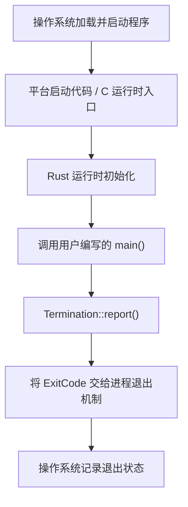

# Rust 程序的启动链路：从 `main` 到 `#[lang]`

## 1. `main` 真的是程序的起点吗？

先看一个最简单的 Rust 程序：

```rust
fn main() {
    println!("Hello, World!");
}
```

在日常开发中，我们通常把 `main` 看作程序的入口。但严格来说，**`main` 是用户代码的逻辑入口，不一定是进程最先执行的代码**。

操作系统启动进程后，通常先进入平台相关的启动代码，经过必要的运行时初始化，再调用我们编写的 `main`。当 `main` 返回时，运行时还需要处理返回值和进程退出状态。



> 这是常规使用标准库的 Rust 程序的概念流程图，并非所有平台、链接方式或 `no_std` 程序都采用完全相同的启动路径。

## 2. `main` 的返回值是什么？

下面的 `main` 没有显式声明返回类型：

```rust
fn main() {
    println!("Hello, World!");
}
```

实际上，它默认返回单元类型 `()`，等价于：

```rust
fn main() -> () {
    println!("Hello, World!");
}
```

`()` 是一个真实的 Rust 类型，表示没有需要传递的有效结果数据，并不等同于“函数不存在返回类型”。

Rust 的 `main` 还可以返回其他类型，但必须满足一个条件：

**`main` 无参数，并且其返回类型必须实现 `Termination` trait。**

例如：

```rust
fn main() -> Result<(), String> {
    Ok(())
}
```

这段代码是合法的，因为 `Result<(), String>` 实现了 `Termination`。

而下面的代码不合法：

```rust
fn main() -> i32 {
    42
}
```

原因不是 `i32` 无法表示退出码，而是 `i32` 本身没有实现 `Termination`。

## 3. `Termination` 是什么？

`Termination` 是标准库提供的一个 trait，用来规定**如何将 `main` 的返回值转换为进程退出状态**。

其核心接口可简化为：

```rust
pub trait Termination {
    fn report(self) -> ExitCode;
}
```

其中：

- `Termination`：约束能够作为 `main` 返回值的类型。
- `report(self)`：消费返回值，将其转换为退出码。
- `ExitCode`：Rust 标准库中表示进程退出码的类型。

例如：

```rust
use std::process::ExitCode;

fn main() -> ExitCode {
    ExitCode::SUCCESS
}
```

### 3.1 常见返回类型及退出状态

| 返回情况 | 通常的退出码 | 说明 |
| --- | ---: | --- |
| `()` | `0` | 正常完成 |
| `Ok(())` | `0` | 成功 |
| `Err(error)` | `1` | 通用失败状态，并输出错误信息 |
| `ExitCode::SUCCESS` | `0` | 显式表示成功 |
| `ExitCode::FAILURE` | `1` | 显式表示失败 |
| 未捕获的 `panic!` | 通常为 `101` | Rust 标准运行时的常见约定，不是语言规范保证 |

补充两点：

1. `Result<T, E>` 实现 `Termination` 时，要求 `T: Termination`、`E: Debug`，不只是要求 `E: Debug`。
2. `!` 是永不返回类型，也实现了 `Termination`；例如永远循环或直接终止执行的函数可以返回 `!`。

### 3.2 为什么 `Result` 的错误类型需要实现 `Debug`？

例如：

```rust
fn main() -> Result<(), String> {
    Err("文件不存在".to_string())
}
```

程序会向标准错误输出（stderr）打印类似：

```text
Error: "文件不存在"
```

这是因为标准库需要使用 `{:?}` 格式化错误，所以错误类型 `E` 必须实现 `Debug`。

## 4. 谁调用了 `Termination::report()`？

我们可以用下面的**概念性伪代码**理解运行时的工作：

```rust
fn runtime_main() {
    initialize_runtime();

    let result = user_main();

    let exit_code = result.report();

    exit_process(exit_code);
}
```

这不是标准库源码的逐字复现。实际实现涉及编译器生成的入口包装代码、标准库运行时和平台相关的启动机制。

重点是：

1. 启动代码先完成必要的初始化。
2. 运行时调用用户的 `main`。
3. `main` 的返回值通过 `Termination::report()` 转换为 `ExitCode`。
4. 退出机制将状态传递给操作系统。

因此，`main` 并不直接负责整个进程的启动和收尾。

## 5. 为什么退出码 `0` 代表成功？

这一约定来自操作系统和 C 语言运行环境的历史习惯，并非 Rust 独有。

通常：

- `0`：成功完成。
- 非 `0`：表示失败或其他非成功状态。

不同程序可以自行约定不同的非零退出码，并不要求所有错误都返回 `1`。

例如：

```rust
use std::process::ExitCode;

fn main() -> ExitCode {
    ExitCode::from(2)
}
```

在 Unix/Linux Shell 中，可以通过 `$?` 查看上一条命令的退出状态：

```bash
./my_program
echo $?
```

如果使用 `cargo run`，`$?` 反映的是 Cargo 命令的退出状态，而不是直接读取子进程的原始状态；因此观察程序本身的退出码时，直接运行编译出的可执行文件更清晰。

另外，未捕获的 `panic!` 在常规 Rust 标准运行时下通常得到退出码 `101`，但这属于实现行为，不是 Rust 语言规范的固定要求；例如 `panic = "abort"` 时行为可能不同。

## 6. `#[lang]` 是什么？

`#[lang = "..."]` 是 Rust 编译器内部使用的一种特殊属性，用于把某个类型、trait 或其他定义标记为**语言项（Language Item，简称 lang item）**。

它的作用可以理解为：

**告诉编译器：这个 Rust 定义对应某项编译器预先约定的语言机制。**

### 6.1 普通 trait 与语言项

普通 trait：

```rust
trait MyTrait {
    fn do_something(&self);
}
```

编译器按通用 trait 规则处理它，不会赋予它某种内建语法含义。

而标准库底层的 `Add` trait 与 `+` 运算符有关，其定义包含类似下面的标记：

```rust
#[lang = "add"]
pub trait Add<Rhs = Self> {
    type Output;

    fn add(self, rhs: Rhs) -> Self::Output;
}
```

这里：

- `Add` 是 Rust 代码中 trait 的名称。
- `"add"` 是编译器认识的语言项标识。
- `#[lang = "add"]` 将该 trait 与编译器内建的加法运算机制关联起来。

因此，表达式 `a + b` 能够通过相应的运算符 trait 机制进行类型检查与方法调用。

### 6.2 `Termination` 为什么是语言项？

`Termination` 的定义包含类似：

```rust
#[lang = "termination"]
pub trait Termination {
    fn report(self) -> ExitCode;
}
```

这个标记让编译器知道：**哪个 trait 用来约束 `main` 函数的返回类型。**

当我们写：

```rust
fn main() -> Result<(), String> {
    Ok(())
}
```

编译器需要检查：

```text
Result<(), String>: Termination
```

即 `Result<(), String>` 是否实现了 `Termination`。

如果满足要求，就允许它作为 `main` 的返回类型，并配合入口包装及运行时机制处理返回状态。

### 6.3 `#[lang]` 与普通属性的区别

| 属性 | 主要用途 |
| --- | --- |
| `#[derive(Debug)]` | 为类型自动生成 trait 实现 |
| `#[inline]` | 提供函数内联提示 |
| `#[cfg(...)]` | 控制条件编译 |
| `#[lang = "..."]` | 将定义与编译器内建语言项关联 |

`#[lang]` 属于不稳定的编译器内部机制，通常出现在 `core` 等底层库中。一般应用开发无需自行编写，也不能把它当作稳定的公共 API 使用。

## 7. 总结

理解 Rust 启动链路，可以抓住以下几个概念：

- **`main`**：用户程序的逻辑入口，但不是整个进程最底层的启动入口。
- **`()`**：`main` 默认的返回类型。
- **`Termination`**：规定 `main` 返回值如何转换为退出状态的 trait。
- **`Termination::report()`**：将返回值转换为 `ExitCode`。
- **`ExitCode`**：表示程序退出状态，成功通常是 `0`，失败通常是非零值。
- **`#[lang]`**：编译器用来识别特殊语言项的内部属性。

最终可以将整个过程概括为：

```text
操作系统 / 平台启动代码
        ↓
Rust 运行时初始化
        ↓
用户编写的 main()
        ↓
Termination::report()
        ↓
ExitCode
        ↓
进程退出并向操作系统报告状态
```

**核心结论：Rust 的 `main` 是用户代码的入口，而 `Termination` 和运行时启动机制共同衔接了用户函数返回值与操作系统进程退出状态。**
